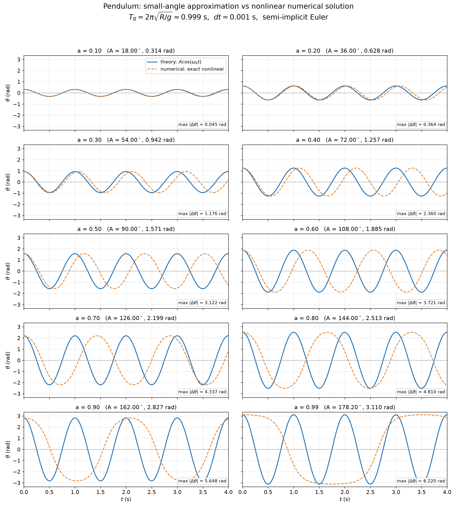
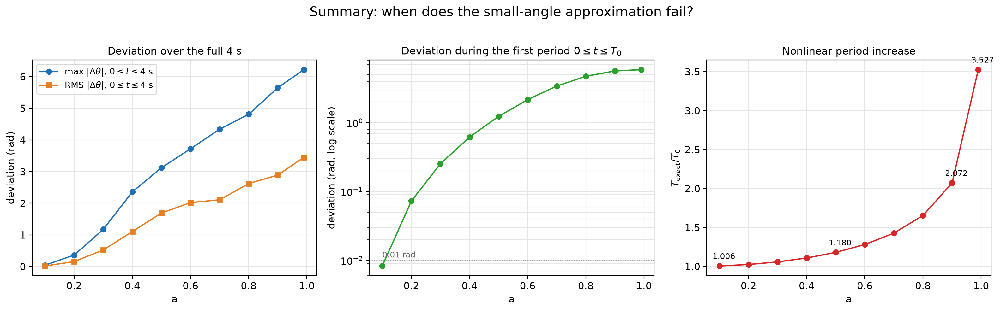
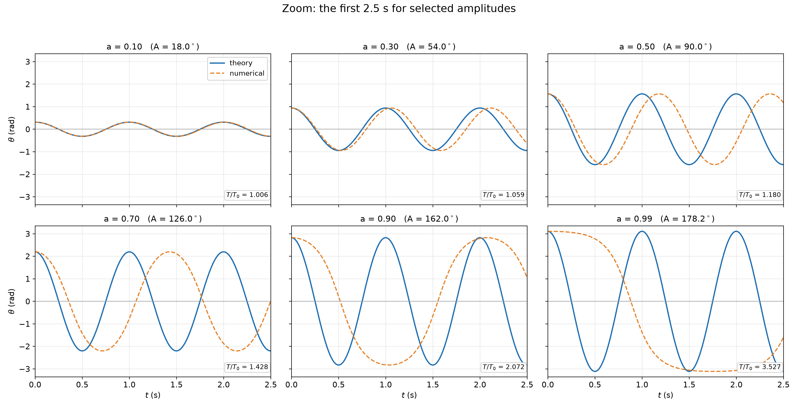

# Analisis: Bandul — solusi sudut kecil vs numerik nonlinear

## Parameter

- `T0 = 1 s`
- `tbeg = 0`, `tend = 4 s`
- `dt = 0.001 s`
- `Tobs = 0.05 s`
- `g = 9.81 m/s²`
- `R = 0.248 m`
- `ω0 = √(g/R) = 6.289392 rad/s`
- `T0 = 2π/ω0 = 0.999013 s`
- Amplitudo: `A = aπ`, dengan `a = 0.1, 0.2, ..., 0.9, 0.99`

## Solusi yang dibandingkan

Solusi teori memakai pendekatan sudut kecil:

```text
θ'' = -(g/R) sin θ ≈ -(g/R) θ
θ_the(t) = A cos(ω0 t)
T0 = 2π/ω0
```

Solusi numerik menyelesaikan persamaan nonlinear penuh:

```text
θ'' = -(g/R) sin θ
```

dengan metode semi-implicit Euler:

```text
w ← w - (g/R) sin(θ) dt
θ ← θ + w dt
```

## Gambar

### Semua amplitudo



### Ringkasan deviasi dan periode



### Zoom 2.5 detik pertama untuk beberapa amplitudo



## Tabel hasil

| a | A (deg) | A (rad) | max \|Δθ\| 0–4 s (rad) | RMS 0–4 s (rad) | max \|Δθ\| 0–T0 (rad) | T_exact/T0 | T_exact (s) |
|---:|---:|---:|---:|---:|---:|---:|---:|
| 0.10 | 18.00 | 0.314 | 0.045 | 0.019 | 0.008 | 1.0062 | 1.0062 |
| 0.20 | 36.00 | 0.628 | 0.364 | 0.159 | 0.073 | 1.0252 | 1.0252 |
| 0.30 | 54.00 | 0.942 | 1.176 | 0.524 | 0.254 | 1.0585 | 1.0585 |
| 0.40 | 72.00 | 1.257 | 2.360 | 1.107 | 0.617 | 1.1087 | 1.1087 |
| 0.50 | 90.00 | 1.571 | 3.122 | 1.693 | 1.235 | 1.1803 | 1.1803 |
| 0.60 | 108.00 | 1.885 | 3.721 | 2.019 | 2.166 | 1.2817 | 1.2817 |
| 0.70 | 126.00 | 2.199 | 4.337 | 2.109 | 3.403 | 1.4283 | 1.4283 |
| 0.80 | 144.00 | 2.513 | 4.810 | 2.622 | 4.734 | 1.6551 | 1.6551 |
| 0.90 | 162.00 | 2.827 | 5.648 | 2.890 | 5.647 | 2.0724 | 2.0724 |
| 0.99 | 178.20 | 3.110 | 6.220 | 3.451 | 5.906 | 3.5270 | 3.5270 |

## Analisis

### 1. `a = 0.1` (A = 18°)

Solusi teori dan numerik hampir berimpit. Deviasi maksimum hanya sekitar
`0.045 rad` (≈ 2.6°) selama 4 detik, dan pada satu periode pertama hanya
`0.008 rad`. Rasio periode `T/T0 = 1.006`, jadi koreksi nonlinear masih
sangat kecil. Pendekatan sudut kecil masih bagus pada rentang waktu ini.

### 2. `a = 0.2` (A = 36°)

Kurva masih terlihat mirip, tetapi sudah ada pergeseran fase yang jelas
menjelang `t = 4 s`. Deviasi maksimum naik menjadi `0.364 rad` (≈ 21°),
walaupun pada periode pertama deviasinya hanya `0.073 rad`. Ini menunjukkan
bahwa kesalahan utama bukan langsung pada bentuk gelombang, melainkan pada
**periode**: `T/T0 = 1.025`, sehingga setelah beberapa siklus fase kedua
solusi bergeser.

### 3. `a = 0.3` sampai `0.5` (54° sampai 90°)

Pergeseran fase semakin cepat. Pada `a = 0.5`, `T/T0 = 1.180`, sehingga
dalam 4 detik solusi teori sudah hampir 1 siklus lebih cepat daripada
solusi numerik. Deviasi maksimum mencapai `3.12 rad`, dan bentuk gelombang
numerik mulai tidak sinusoidal sempurna.

### 4. `a = 0.6` sampai `0.8` (108° sampai 144°)

Amplitudo sudah besar. Solusi teori tetap berosilasi dengan periode
`T0 = 0.999 s`, sedangkan solusi numerik memiliki periode yang jauh lebih
panjang:

- `a = 0.6`: `T/T0 = 1.282`
- `a = 0.7`: `T/T0 = 1.428`
- `a = 0.8`: `T/T0 = 1.655`

Karena itu, pada `t = 4 s` kedua kurva sudah beberapa kali berlawanan fase.
Deviasi maksimum berkisar `3.7–4.8 rad`.

### 5. `a = 0.9` dan `a = 0.99` (162° dan 178°)

Ini adalah kasus mendekati titik pemisah (separatrix), yaitu posisi bandul
terbalik. Periode nonlinear meningkat sangat tajam:

- `a = 0.9`: `T/T0 = 2.072`
- `a = 0.99`: `T/T0 = 3.527`

Dalam 4 detik, solusi teori menyelesaikan sekitar 4 siklus, sedangkan solusi
numerik hanya sekitar 1.9 siklus (`a = 0.9`) atau 1.1 siklus (`a = 0.99`).
Akibatnya deviasi maksimum mencapai `5.65 rad` dan `6.22 rad`, yaitu praktis
berlawanan fase.

## Rumus periode nonlinear

Periode eksak bandul untuk amplitudo `A` adalah:

```text
T_exact = 4 √(R/g) K(sin(A/2))
        = T0 (2/π) K(sin(A/2))
```

dengan `K(k)` adalah integral eliptik lengkap jenis pertama. Nilai
`T_exact/T0` pada tabel di atas dihitung dari rumus ini.

## Verifikasi numerik

Metode semi-implicit Euler dengan `dt = 0.001` sudah cukup akurat untuk
perbandingan ini. Pengecekan dengan `dt = 0.0001` memberikan perbedaan
posisi sudut maksimum sekitar `0.004–0.006 rad` selama 4 detik. Perbedaan
teori–numerik yang mencapai beberapa radian karena itu berasal dari fisika
(periode nonlinear), bukan dari error integrasi.

Periode numerik yang diukur dari zero crossing juga cocok dengan rumus
eliptik:

| a | T_numerik/T0 | T_eksak/T0 |
|---:|---:|---:|
| 0.50 | 1.18034 | 1.1803 |
| 0.90 | 2.07239 | 2.0724 |
| 0.99 | 3.52700 | 3.5270 |

## Kesimpulan

- Pendekatan sudut kecil sangat baik untuk `a` kecil, misalnya `a = 0.1`
  (18°) selama 4 detik.
- Untuk `a = 0.2` (36°) ke atas, kesalahan mulai terlihat terutama karena
  pergeseran fase akibat periode nonlinear yang lebih panjang.
- Semakin besar amplitudo, semakin besar kesalahan periode. Pada
  `a = 0.99` (178°), periode numerik hampir 3.5 kali periode sudut kecil.
- Selama amplitudo masih kecil (kira-kira `A ≲ 20°`), `θ_the = A cos(ω0t)`
  masih merupakan aproksimasi yang baik. Untuk amplitudo besar, diperlukan
  solusi nonlinear.

## File

- `pendulum-grid.png` — semua amplitudo, teori vs numerik
- `pendulum-summary.png` — ringkasan deviasi dan periode
- `pendulum-selected.png` — zoom 2.5 s pertama
- `pendulum-metrics.csv` — data numerik tabel
- `../pendulum.html` — halaman interaktif dengan console dan grafik Chart.js
